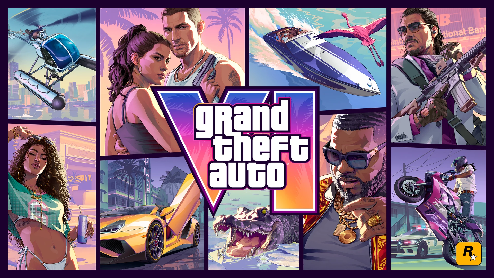

# 🌴 Grand Theft Auto VI — Leonida Experience

<div align="center">



### An immersive, interactive cinematic web experience celebrating Grand Theft Auto VI and the state of Leonida.

[](https://gta6-leonida-website-main.vercel.app)
[](https://nextjs.org/)
[](https://react.dev/)
[](https://www.typescriptlang.org/)
[](https://threejs.org/)
[](https://greensock.com/)

[**Explore Live Experience**](https://gta6-leonida-website-main.vercel.app) · [**Report Issue**](https://github.com/rakibul1548/gta6-leonida-nextjs/issues)

</div>

---

## 🌟 Overview

The **Leonida Experience** is an interactive fan tribute to Rockstar Games' upcoming title, **Grand Theft Auto VI**. Built with cutting-edge web technologies, it features custom WebGL shaders, interactive character dossiers, dynamic road-trip navigation across Leonida, authentic retro audio synthesis, and hidden Easter eggs.

---

## ✨ Features

- 🎮 **Authentic Boot Sequence**: Classic GTA-style loading screen with real-time tips, audio opt-in, and streaming asset indicators.
- 🌴 **Explore Leonida (3D Road Trip)**: Smooth WebGL-powered 3D tour through iconic locations:
  - *Vice City*, *Port Gellhorn*, *Ambrosia*, *Mount Kalaga National Park*, *Leonida Keys*, and *Grassrivers*.
- 👥 **Choose Your Lead & Character Dossiers**:
  - Interactive dossiers for **Jason Duval**, **Lucia Caminos**, **Dre'Quan Priest**, **Boobie Ike**, **Cal Hampton**, and more.
  - Instant high-resolution fallback portraits with seamless video playback transitions.
- 📻 **Interactive Radio & Sound Engine**:
  - Web Audio API custom synthesizer with Vice City FM tuner, rotary dial, frequency switching, and sound FX.
- ⌨️ **Classic Cheat Codes**:
  - Full keyboard cheat engine supporting classic combinations (e.g., `PANZER`, `TURTLE`, `SLOWMO`, `SEAWAYS`, `LAWYERUP`, `SKYDIVE`).
- 📸 **Cover & Card Creator**:
  - Custom canvas generator allowing users to export their own GTA VI character trading cards and covers.
- 📱 **100% Fully Responsive**:
  - Custom layouts tailored for ultra-wide displays, laptops, tablets, and mobile devices (iOS Safari & Android).
- 🚀 **Performance Optimized**:
  - Instant image decoding, lazy-loaded WebGL textures, Lenis ultra-smooth scrolling, and 1-year immutable caching on media assets.

---

## 🛠️ Tech Stack

| Layer | Technology |
|---|---|
| **Framework** | [Next.js 16](https://nextjs.org/) (App Router) |
| **UI Library** | [React 19](https://react.dev/) |
| **Language** | [TypeScript 5.7](https://www.typescriptlang.org/) |
| **3D & Shaders** | [Three.js](https://threejs.org/) (Custom WebGL Canvas, Post-processing) |
| **Animations** | [GSAP](https://greensock.com/) (GreenSock) + ScrollTrigger |
| **Smooth Scroll** | [Lenis](https://lenis.darkroom.engineering/) |
| **State Management** | [Zustand](https://github.com/pmndrs/zustand) |
| **Audio** | Custom Web Audio API Procedural Synthesizer & SFX |
| **Styling** | Modern CSS Variables, Clamp Fluid Typography, Safe-Area insets |
| **Deployment** | [Vercel](https://vercel.com/) |

---

## 📂 Project Architecture

```
gta6-leonida-website/
├── public/
│   ├── media/
│   │   ├── a/            # Character art & key visual variants (landscape, portrait, phone)
│   │   ├── c/            # Character video clips & animated posters (WebP & MP4)
│   │   └── s/            # Official 4K screenshots & location captures
│   └── favicon.ico
├── src/
│   ├── app/
│   │   ├── layout.tsx    # Root layout with metadata & fonts
│   │   └── page.tsx      # Main application page
│   ├── audio/
│   │   └── engine.ts     # Procedural audio engine, radio synthesizer & sfx
│   ├── chapters/
│   │   ├── Boot.tsx      # GTA loading screen chapter
│   │   ├── Hero.tsx      # Landing hero with countdown, trailer & radio dial
│   │   ├── Saga.tsx      # Lucia & Jason introduction cards
│   │   ├── Story.tsx     # Narrative split screens
│   │   ├── Leonida.tsx   # Interactive 3D map & road trip
│   │   ├── Lead.tsx      # Cast selector & character carousel
│   │   ├── Gameplay.tsx  # In-game footage feeds & lightbox
│   │   ├── Cover.tsx     # Custom cover and card generator
│   │   └── Finale.tsx    # Footer and release countdown
│   ├── content/
│   │   ├── cast.ts       # Cast bios, traits, and metadata
│   │   ├── media.ts      # Responsive media resolver & pickers
│   │   └── world.ts      # Chapters, regions, cheats & secrets
│   ├── game/
│   │   ├── cheats.ts     # Keyboard cheat code evaluator
│   │   ├── overlays.tsx  # Pause menu, dossier modal & card maker
│   │   ├── scroll.ts     # Lenis scroll controller & GSAP ticker
│   │   └── store.ts      # Global game state (Zustand)
│   ├── gl/
│   │   ├── hero.ts       # Hero WebGL background scene
│   │   ├── stage.ts      # Global Three.js render pipeline
│   │   └── trip.ts       # Leonida 3D road trip camera & terrain shaders
│   └── styles/
│       ├── app.css       # Chapter-specific styling & media queries
│       └── global.css    # Core reset, design tokens & typography
├── package.json
└── tsconfig.json
```

---

## 🚀 Getting Started

### Prerequisites

Ensure you have the following installed:
- **Node.js** 20.x or higher
- **npm**, **pnpm**, or **yarn**

### Installation

1. **Clone the repository**:
   ```bash
   git clone https://github.com/rakibul1548/gta6-leonida-nextjs.git
   cd gta6-leonida-nextjs
   ```

2. **Install dependencies**:
   ```bash
   npm install
   ```

3. **Run the local development server**:
   ```bash
   npm run dev
   ```

4. **Open your browser**:
   Navigate to [http://localhost:3000](http://localhost:3000).

### Production Build

To test the production build locally:

```bash
npm run build
npm run start
```

---

## 🎮 Easter Eggs & Cheats

While browsing the website, you can type classic Grand Theft Auto cheat codes on your keyboard:

| Cheat Code | Effect |
|---|---|
| `PANZER` | Wanted Level Siren Mode |
| `SLOWMO` | Bullet Time Matrix Slow-Motion |
| `SEAWAYS` | Ocean & Neon Water Pulse |
| `LAWYERUP` | Clear Active Overlays & Reset |
| `TURTLE` | Full Health / Shield SFX |

---

## ⚖️ Legal Disclaimer

This is a **non-commercial, fan-made interactive tribute**. 

All intellectual property rights, trademarks, names, logos, character designs, artwork, and footage of **Grand Theft Auto**, **Grand Theft Auto VI**, **Vice City**, and the **Rockstar Games** logo belong exclusively to **Rockstar Games** and **Take-Two Interactive Software, Inc.** 

This project is not affiliated with, endorsed, sponsored, or specifically approved by Rockstar Games or Take-Two Interactive.

---

## 👨‍💻 Author

Developed with ❤️ by **[Md Rakibul](https://github.com/rakibul1548)**

- **Live URL**: [https://gta6-leonida-website-main.vercel.app](https://gta6-leonida-website-main.vercel.app)
- **Repository**: [https://github.com/rakibul1548/gta6-leonida-nextjs](https://github.com/rakibul1548/gta6-leonida-nextjs)
